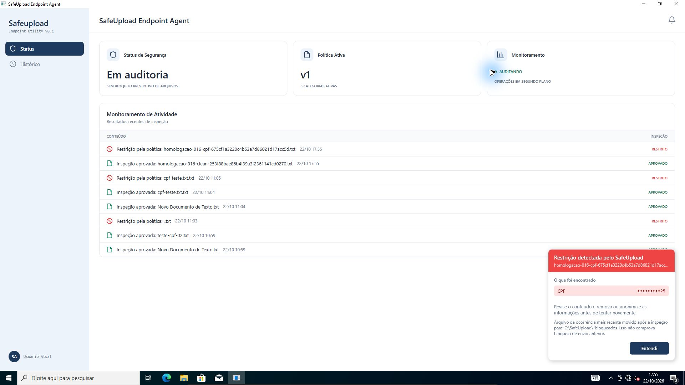
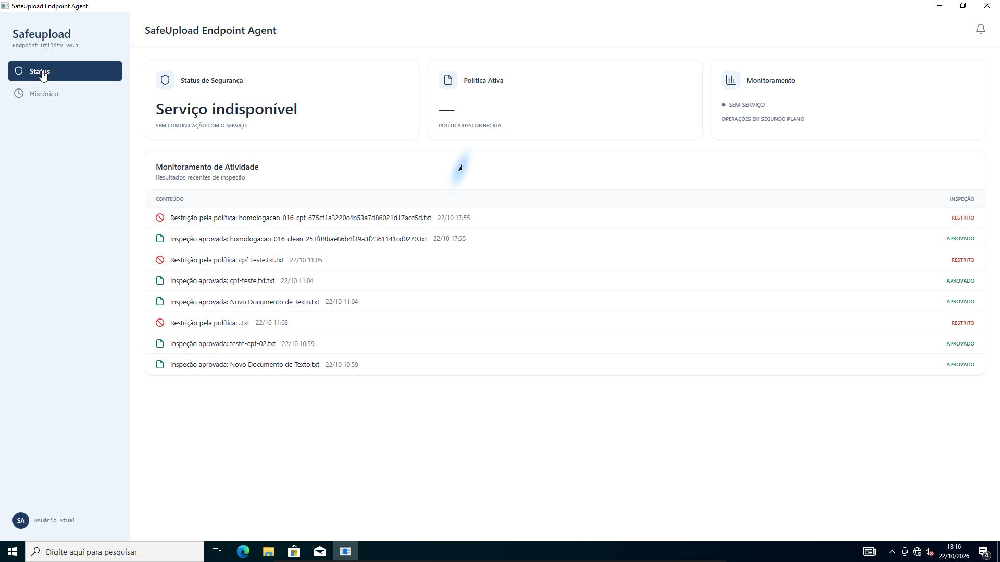
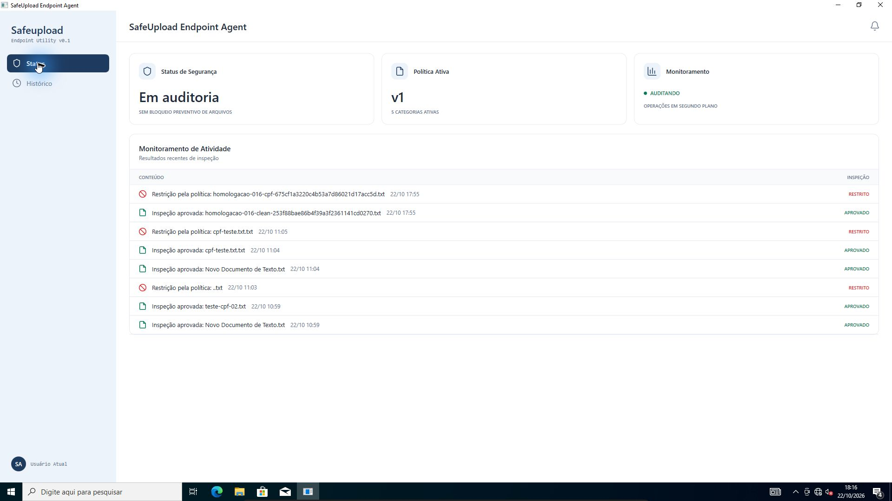
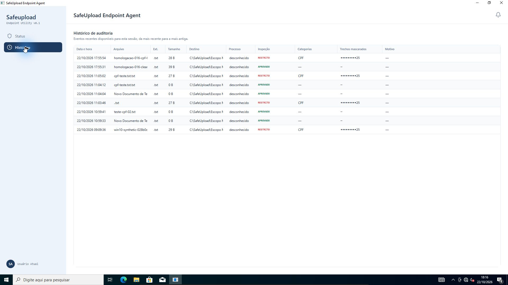

# Homologação do candidato 0.1.6 no Windows 10 — 22/10/2026

**Resultado: instalação, dados preservados, startup, interface, reconexão e
desinstalação aprovados nesta rodada no clone isolado.** O teste usa FileSystemWatcher,
sem API externa e sem driver. Não comprova bloqueio preventivo.

## Pacote e troca de versão

Instalador do [CI 39802402784](https://github.com/pedro-canafistula/safeupload/actions/runs/39802402784),
fonte limpa 0e9e05d1562f64d3b384a2426307d3644c9340f3.
SHA-256: 44D7A2751696F6B873CD50D15F1343829E268BCCF153677D744FD67521C6499C.
O clone é SafeUpload-Homologacao-Win10-20261021,
UUID 3a9992db-4644-405c-b642-9766edd10650. A VM original não foi alterada.

O roteiro verificou UUID, pacote, manifesto, origem e DLLs do 0.1.5, serviço
LocalSystem e ausência do driver. Com elevação confirmada pelo usuário:

1. Parou o serviço e guardou cópias locais da política e da fila no laboratório.
2. Encerrou somente a UI do caminho esperado e removeu o 0.1.5. Serviço e
   entrada de startup ficaram ausentes; política e fila mantiveram seus hashes.
3. Instalou o 0.1.6 e conferiu **724 arquivos instalados** contra o manifesto.
   Serviço voltou Running/LocalSystem; hashes da política e fila continuaram
   idênticos. Os sete eventos anteriores permaneceram disponíveis.

A troca ocorreu entre **15:28:51 e 15:29:24 UTC** (12:28:51–12:29:24 em Brasília).
Isso é **remoção seguida de reinstalação**, não homologação de upgrade ou rollback.
Os logs completos das duas etapas foram coletados e versionados.

## Retomada após desligamento e login

A revisão automática atingiu o limite de uso antes de executar a consulta e a
coleta de logs seguintes; nenhuma aprovação foi inferida da chamada interrompida.
Na retomada, a sessão remota anterior havia expirado e o clone estava desligado.
Foi ligado apenas o clone, mantendo NICs desativadas, clipboard e drag-and-drop
desativados e nenhuma pasta compartilhada.

Depois do login feito pelo usuário, encontrou-se UI PID **6504**, sessão 1,
com Explorer PID **4448** como pai. Sua criação ocorreu **15,259 segundos** após
o Explorer; o serviço PID **2900** estava na sessão 0. O assistente não executou
comando de lançamento da UI neste novo boot: abriu o painel pelo ícone existente
na bandeja. A abertura inicial de teste feita antes da interrupção pertence ao
boot anterior, não é a evidência deste startup.

O painel exibiu política v1, cinco categorias e “Sem bloqueio preventivo de
arquivos”. A leitura do pipe sem elevação recebeu os sete eventos originais.
Nenhum alerta antigo foi observado ao abrir esse painel.

## Arquivos sintéticos com painel aberto

| Cenário | Resultado observado |
| --- | --- |
| Texto limpo, 39 B | Approved, Quarantined=false; permaneceu na pasta monitorada; UI mostrou “Inspeção aprovada” e APROVADO. |
| CPF de teste, 28 B | Blocked, Quarantined=true; saiu da pasta monitorada e o conteúdo foi conferido em C:\SafeUpload\_bloqueados. |
| Aviso do CPF | “Restrição detectada pelo SafeUpload”, CPF mascarado terminando em 25, caminho real e indicação de movimentação após a inspeção. |
| Histórico final | Nove EventIds únicos: sete anteriores e dois novos, cada um exatamente uma vez. Coluna Inspeção com APROVADO / RESTRITO. |

Os testes de arquivo e a consulta final do pipe rodaram com token **sem
elevação**, na sessão 1. A atividade recente conserva seu limite de oito itens;
o Histórico mostrou os nove registros. O veredito persistido não foi renomeado:
APROVADO / RESTRITO são rótulos de apresentação.

Evidências em [resumo e hashes](evidencias/homologacao-win10-016-20261022/resumo.json):
[instalação](evidencias/homologacao-win10-016-20261022/vm-install-016.json),
[startup](evidencias/homologacao-win10-016-20261022/vm-startup-016.json),
[arquivo limpo](evidencias/homologacao-win10-016-20261022/vm-clean-016.json),
[CPF](evidencias/homologacao-win10-016-20261022/vm-cpf-016.json),
[log de remoção](evidencias/homologacao-win10-016-20261022/vm-uninstall-015.log)
e [log de instalação](evidencias/homologacao-win10-016-20261022/vm-install-016.log).
Os recibos de execução deixam a observação visual como pendente: ela foi
conferida separadamente e registrada neste relatório e no resumo.

## Limites e próximos aceites

- Falha de movimentação foi coberta nos testes C# do candidato, não provocada
  nesta rodada na VM. As capturas são observações pontuais, sem medir
  continuamente a latência.
- Desinstalações do **0.1.5** e do **0.1.6** com dados preservados foram aprovadas
  no Windows 10; reconexão com painel aberto foi aprovada nas duas versões.
- Windows 11, assinatura da equipe, upgrade/repair/rollback, integração com API
  real, par exato do driver e longevidade da fila permanecem pendentes.

O clone foi deixado **sem o agente instalado**, com política, fila e quarentena
preservadas após o ensaio final abaixo. A sessão com
credencial em memória foi encerrada. PR #49 e PR #42 continuam em rascunho,
sem merge. Esta entrega acrescenta apenas roteiro/evidências/documentação;
o CI de produto aprovado continua sendo o da fonte 0e9e05d1.

## Reconexão e desinstalação final do 0.1.6

Ensaio entre **21:15:58 e 21:17:11 UTC** (18:15:58–18:17:11 em Brasília),
com confirmação local da elevação pelo usuário. O roteiro verificou novamente
UUID do clone, versão/commit, modo sem API, ausência do driver, serviço
LocalSystem e uma única UI no caminho instalado. Uma etapa de espera cancelaria
a remoção se a conferência do painel não fosse recebida em até 180 segundos.

- Serviço parado às 21:15:58.731Z; painel mostrou “Serviço indisponível”, política
  desconhecida e “SEM SERVIÇO”, mantendo as atividades recentes.
- Serviço voltou Running às 21:16:32.071Z, PID **2900 → 5708**. A UI continuou
  PID **6504**, mesma data de criação; recuperou auditoria, política v1 e cinco
  categorias sem ser reaberta. Nenhum alerta antigo foi observado.
- Pipe consultado sem elevação retornou os mesmos **nove EventIds únicos**;
  o conjunto foi comparado ao recibo anterior. Histórico visual com nove linhas.
- Depois dessa conferência, o desinstalador retornou **0**. Serviço e seu registro,
  entrada HKLM Run, UI e executáveis instalados ficaram ausentes. Consulta
  independente sem elevação confirmou ausência do serviço, startup e processo.
- Política, fila e arquivo sintético em quarentena conservaram seus SHA-256.
  A fila continuou com os mesmos nove eventos. As ACLs não foram ampliadas:
  uma consulta adicional sem elevação aos dados protegidos recebeu acesso negado;
  a comprovação dos hashes vem do roteiro elevado, não dessa consulta.

| Dado preservado | SHA-256 antes/depois |
| --- | --- |
| Política | 16979B6447FE37E98270729DEEAAFC5BA741AC4509BEF9730B2F11FFB093D90F |
| Fila | CFCAE771B1ACC370A10850853FF18103C780C3A2D69512253D4832C87C09C9EB |
| CPF sintético em quarentena | 605A58E33E73F44BEC1E10A8B7C842A4805BB353A2544005FAFC53F2445A2E81 |

O log bruto contém 778 linhas e foi inspecionado antes da publicação. Registra
uma tentativa de remover diretório ocupado (145), seguida por “Removed all? Yes”,
sucesso e nenhuma necessidade de reinício; as verificações finais acima passaram.
Não houve remoção manual de diretórios. A VM original permaneceu desligada.

Evidências adicionais na mesma pasta: `vm-encerramento-016.json`,
`vm-pipe-reconexao-016.json`, `vm-apos-remocao-016.json`,
`Validar-Encerramento-016.ps1`, `vm-uninstall-016-final.log` e
`resumo-encerramento.json` com hashes dos arquivos desta entrega.
O transporte do recibo do pipe trouxe U+0007 em trechos mascarados. Esses
caracteres de controle foram apenas escapados como `\u0007` para JSON válido;
EventIds e valores foram preservados. O resumo inclui também o hash do recibo
original, mantido no laboratório local. O log bruto não foi normalizado.

