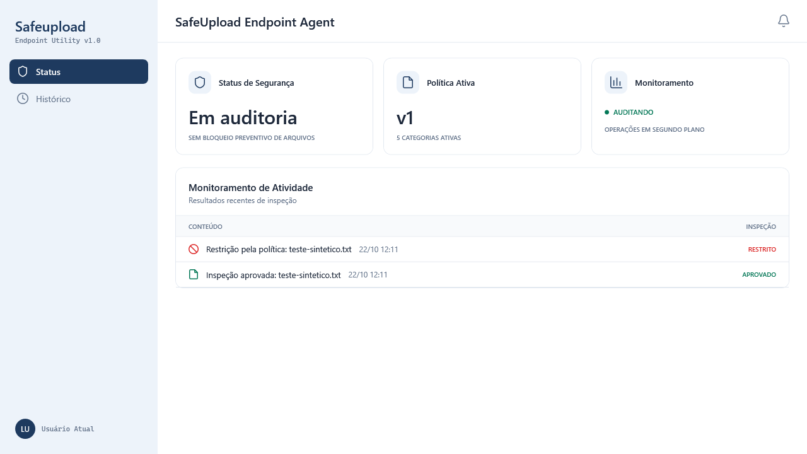
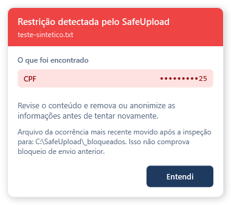
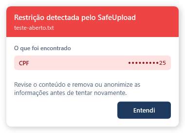

# Textos de inspeção e confirmação de quarentena — 22/10/2026

O painel mostrava “Arquivo enviado” e “Upload bloqueado” a partir apenas do
veredito. No FileSystemWatcher, a inspeção começa após a gravação; um veredito
Blocked não comprova bloqueio preventivo nem envio. O histórico também não
registra o modo operacional de cada evento antigo.

## Entrega

- Atividade: “Inspeção aprovada” ou “Restrição pela política”. Status e Histórico
  usam APROVADO / RESTRITO na coluna Inspeção, sem mudar o veredito persistido.
- Cartão de auditoria: “Sem bloqueio preventivo de arquivos”. Isso permite
  distinguir a observação da movimentação posterior para quarentena.
- Aviso: “Restrição detectada pelo SafeUpload”; agregação conta ocorrências,
  sem afirmar que arquivos foram enviados ou preventivamente barrados.
- O caminho de quarentena vem de AgentPaths.QuarantineFolder, atualmente
  C:\SafeUpload\_bloqueados. A mensagem anterior apontava incorretamente para
  a pasta do usuário. A indicação aparece somente com Quarantined confirmado.
- O watcher anunciava Quarantined=true sempre que o resultado era Blocked,
  mesmo se File.Move falhasse. A movimentação agora retorna sucesso/falha e
  esse resultado alimenta a notificação. Falha não muda a decisão nem a auditoria.
- As notificações específicas de transferência com staging, seus recibos,
  justificativas e o bloqueio do clipboard mantêm seu fluxo próprio.

Não se usa o status atual para reinterpretar eventos antigos. Não houve migração
da fila, mudança no JSON, ACLs, autenticação ou configuração da VM. Java, Angular,
banco e driver não foram editados.

## Validação local

Fonte de implementação: 0e9e05d1562f64d3b384a2426307d3644c9340f3.
Lotes direcionados: **24 aprovados, zero falhas**, tanto Debug quanto Release,
incluindo histórico, protocolo e dois testes novos de movimentação real:

1. Movimentação bem-sucedida preserva o conteúdo e não sobrescreve arquivos
   anteriores com o mesmo nome.
2. Arquivo aberto sem compartilhamento de exclusão permanece intacto e não
   é anunciado como movido.

O SDK no sandbox encontrou acesso negado ao gerenciador de serviços antes de
executar testes. A execução autorizada fora do sandbox compilou WPF e passou;
nenhuma asserção foi relaxada.

Prévia WPF renderizada com dados sintéticos, sem iniciar App, pipes, clipboard,
serviço ou janelas visíveis. Revisadas telas de Status, Histórico e aviso com e
sem confirmação de movimentação. Isto **não é homologação na VM**. Capturas e
hashes: [evidências locais](evidencias/textos-auditoria-20261022/validacao-local.json).

## Candidato e limites

Novo candidato **0.1.6**, para distinguir os binários da versão 0.1.5 já
homologada. [CI 39802402784](https://github.com/pedro-canafistula/safeupload/actions/runs/39802402784)
aprovado para a fonte de implementação: três jobs concluídos com sucesso.
C# completo sem filtros: **749 aprovados, zero falhas e quatro skips já existentes
em 753 casos**, tanto Debug quanto Release. Contratos PowerShell 7 e 5.1:
**39/39** cada; ambiente **4/4**. No Windows Server 2025 descartável, passaram
instalação self-contained como LocalSystem, classificação de CPF sintético,
reinício preservando evento e política, recusa de sobrescrita e desinstalação
preservando política/fila. O ensaio não testou o driver real.

Os três ZIPs foram baixados e seus hashes confrontados com o GitHub; os dois
TRX foram lidos. EXE **84.024.610 bytes**, 724 arquivos de payload, sem assinatura:
SHA-256 **44D7A2751696F6B873CD50D15F1343829E268BCCF153677D744FD67521C6499C**,
igual ao recibo de build e à validação estática do runner.
Recibos: [CI e hashes](evidencias/textos-auditoria-20261022/ci-016.json),
[instalação real no runner](evidencias/textos-auditoria-20261022/instalacao-runner.json)
e [validação estática](evidencias/textos-auditoria-20261022/validacao-pacote-runner.json).
Fonte limpa, sem mudanças locais no build. O clone agora está com 0.1.6:
[homologação ao vivo](HOMOLOGACAO-WIN10-016-20261022.md). As evidências anteriores
de reconexão pertencem ao 0.1.5; o novo relatório registra instalação, startup
observado, arquivo limpo, CPF e nove eventos preservados no Histórico.

- [x] Corrigir linguagem e confirmação de movimentação no código do agente.
- [x] Compilar WPF e passar testes direcionados em Debug/Release.
- [x] Revisar prévias renderizadas de Status, Histórico e avisos.
- [x] Concluir CI completo e verificar o artefato 0.1.6.
- [x] Instalar o artefato conferido no clone e validar os textos ao vivo.
- [x] Remover 0.1.5 no Windows 10 preservando política e fila; logs coletados.
- [ ] Validar a desinstalação do 0.1.6 no Windows 10 preservando política e fila.

API de política, Windows 11, assinatura, upgrade/repair/rollback e driver real
continuam pendentes. PRs #49 e #42 permanecem em rascunho, sem merge.
