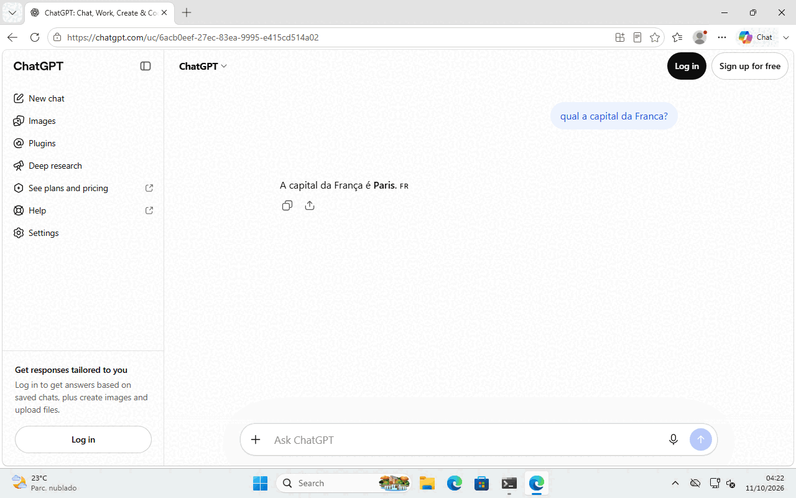
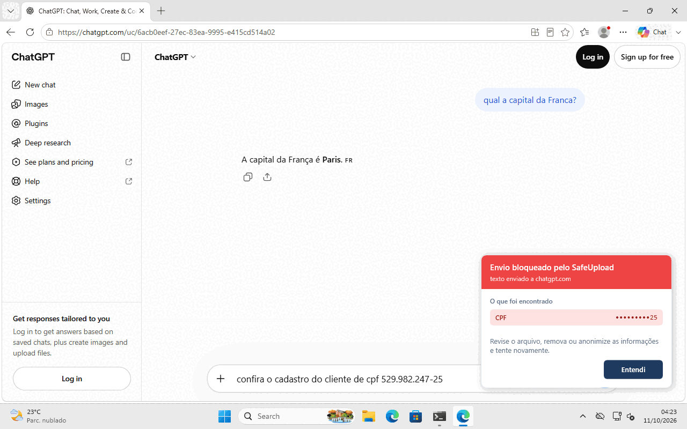
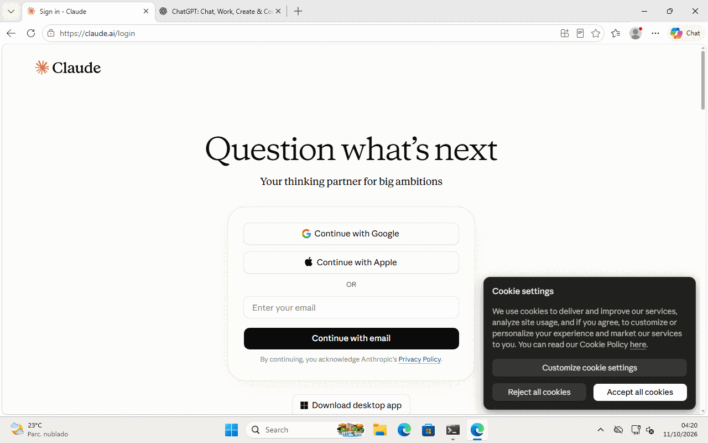
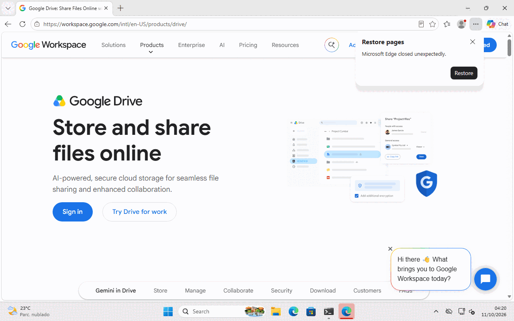
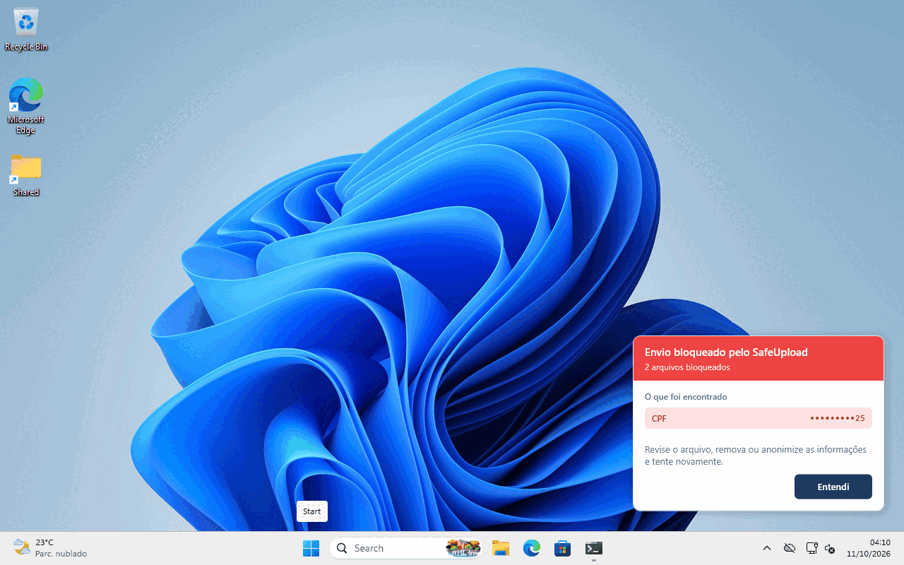

# Fase 7 — Qualificação da inspeção TLS

Resultado da qualificação feita em 11/10/2026 na VM Windows 11 (build 26200),
com o Microsoft Edge e o agente da branch `feat/inspecao-tls-fase7`. O que
está implementado e por quê está em
[ARQUITETURA-INSPECAO-TLS.md](ARQUITETURA-INSPECAO-TLS.md); este documento
registra o que foi medido, o que quebrou e o que foi corrigido.

## Resumo

| Pergunta | Resposta |
|---|---|
| Os sites abrem pelo proxy? | Sim. 16 sites testados; nenhum deixou de abrir por causa do proxy. |
| O upload com dado sensível é barrado num navegador de verdade? | Sim: formulário com arquivo, JSON, `PUT` de arquivo e formulário simples, e um prompt com CPF no ChatGPT de verdade. |
| O que é limpo passa? | Sim, inclusive a resposta em streaming do ChatGPT. |
| O usuário é avisado? | Sim, a janela do aplicativo de bandeja aparece na sessão dele. |
| Quanto o proxy atrasa? | Nada mensurável com curl (diferença dentro do ruído). |
| O que quebrou na primeira rodada? | Três defeitos sérios, corrigidos nesta fase (seção 3). |
| O que não foi testado? | Upload com login em Drive e Gmail, Chrome e Firefox, uso prolongado (seção 6). |

## 1. Como foi testado

Condições iguais às de produção, o mais perto que a VM permite:

- Serviço rodando como **SYSTEM** (tarefa agendada), com
  `InspecaoTls:Habilitada=true` e o desvio dos navegadores ligado.
- Aplicativo de bandeja aberto na **sessão interativa** do usuário (sessão 1).
- Edge iniciado na sessão do usuário, com as políticas de proxy e o filtro WFP
  em vigor. Nada foi configurado no navegador.
- Painel de administração fora do ar: a política é a padrão (CPF, CNPJ,
  cartão, senha e segredo ativos).

Os roteiros estão em [evidencias/fase7/roteiro](evidencias/fase7/roteiro). Os
caminhos (`C:\src\q`, `C:\src\agente`) são os da VM de teste.

| Roteiro | O que faz |
|---|---|
| `run-all.ps1` | Rodada de referência sem o proxy, depois a mesma coisa com o proxy, latência e resumo do log e da fila. |
| `job-browser.ps1` | Edge sem janela: uploads por `fetch` (`upload.html`), formulário por navegação (`form.html`) e captura de 16 sites. |
| `job-real.ps1` | Edge com janela de verdade em ChatGPT, Claude, Drive e Outlook, com captura da tela. |
| `job-chat.ps1` | Digita um prompt limpo e um prompt com CPF no ChatGPT de verdade (sem login). |
| `job-down.ps1` | Comportamento com o serviço morto e depois de `desvio remove`. |

## 2. Resultados

### 2.1 Uploads pelo Edge

Página local que envia para `httpbin.org` com `fetch`, e um formulário HTML
enviado por navegação.

| Envio | Resultado | Evento na fila |
|---|---|---|
| Formulário multipart com `folha.csv` contendo CPF | **Barrado** | `Blocked`, `folha.csv`, CPF |
| Formulário multipart com `setores.csv` limpo | Passou (200) | `Approved`, `setores.csv` |
| JSON no formato de prompt com CPF | **Barrado** | `Blocked`, texto, CPF |
| JSON no formato de prompt, limpo | Passou (200) | nenhum |
| `PUT` com o conteúdo do arquivo, com CPF | **Barrado** | agrupado com o anterior (mesmo achado, mesmo site, menos de 60 s) |
| `GET` simples | Passou (200) | nenhum |
| Formulário HTML com campo `cpf`, enviado por navegação | **Barrado**; o navegador mostra "SafeUpload bloqueou este envio. Dados sensíveis encontrados: Cpf." | `Blocked`, texto, CPF |

Para o `fetch`, o bloqueio aparece como falha de rede (`TypeError`): o 403 do
proxy não tem cabeçalhos CORS, então a página não chega a ler a resposta. Para
o site, é "o envio falhou".

Todos os eventos saíram com `"channel":"Web"`, usuário `safeupload` (o dono do
navegador, e não a conta SYSTEM do serviço) e processo `msedge`.

### 2.2 ChatGPT de verdade

Edge com janela, `chatgpt.com` sem login, texto digitado na caixa de prompt.

| Prompt | Resultado |
|---|---|
| "qual a capital da Franca?" | Respondido normalmente, com a resposta chegando em streaming. |
| "confira o cadastro do cliente de cpf 529.982.247-25" | **Barrado.** O prompt não saiu, e a bandeja mostrou "Envio bloqueado pelo SafeUpload — texto enviado a chatgpt.com — CPF •••••••••25". |

O endereço barrado foi `POST https://chatgpt.com/unauth-mweb/conversation/updates`
(o fluxo sem login). Um bloqueio só, um evento só.

### 2.3 Matriz de sites

Edge sem janela, captura de tela de cada site, com e sem o proxy. Tempo até a
captura, em milissegundos; "esgotou" é 90 s sem a captura sair.

| Site | Sem o proxy | Com o proxy | Observação |
|---|---|---|---|
| google.com | 8115 | 2806 | |
| pt.wikipedia.org | 1978 | 2254 | |
| github.com | 3906 | 4495 | |
| youtube.com | 3350 | 5150 | |
| drive.google.com | esgotou | esgotou | Não é o proxy: esgota igual sem ele. Com janela de verdade, abre (abaixo). |
| mail.google.com | 4663 | 5100 | Página de login. |
| chatgpt.com | 1452 | 1949 | Sem janela, o Cloudflare segura na verificação de robô, com e sem o proxy. Com janela, abre. |
| outlook.live.com | esgotou | esgotou | Igual ao Drive. |
| web.whatsapp.com | 5321 | 5540 | |
| dropbox.com | 15311 | 45383 | Abriu nos dois. Mais lento pelo proxy nesta rodada (uma medição só). |
| wetransfer.com | esgotou | 35590 | |
| onedrive.live.com | 14374 | 15978 | |
| bb.com.br | 2341 | 1451 | Em túnel (exceção: bancos). |
| gov.br | 2525 | 2978 | Em túnel (exceção: governo). |
| claude.ai | 1400 | 1539 | Mesmo caso do ChatGPT. |
| gemini.google.com | 4242 | 4733 | |

Os tempos são de uma rodada só e variam bastante entre rodadas; servem para
dizer que nada quebrou, não para medir desempenho.

Com janela de verdade e pelo proxy, ChatGPT, Claude, Drive e Outlook abriram.
A verificação de robô do Cloudflare passou.

Com o proxy corrigido, a rodada inteira (16 sites, mais os quatro com janela)
produziu **zero bloqueios indevidos** e **zero hosts mandados para o túnel por
engano**.

### 2.4 Latência

`curl`, mediana de 5 requisições, direto e pelo proxy.

| Endereço | Direto | Pelo proxy | Diferença |
|---|---|---|---|
| google.com | 0,360 s | 0,354 s | −6 ms |
| pt.wikipedia.org | 0,134 s | 0,136 s | +2 ms |
| github.com | 0,407 s | 0,400 s | −8 ms |
| httpbin.org/get | 0,637 s | 0,493 s | −145 ms |
| gov.br (túnel) | 0,267 s | 0,254 s | −13 ms |

A diferença está dentro do ruído da rede. O custo do proxy numa requisição sem
corpo não aparece nesta medição. Requisição com corpo paga a inspeção; isso
não foi medido em separado.

### 2.5 Aviso ao usuário

A janela do aplicativo de bandeja apareceu na sessão do usuário nos dois casos:
upload de arquivo ("2 arquivos bloqueados", quando dois bloqueios chegam
juntos) e texto ("texto enviado a chatgpt.com").

O texto fixo da janela ainda fala em "arquivo" mesmo quando o achado é texto
digitado.

### 2.6 Proxy fora do ar

| Situação | Edge |
|---|---|
| Serviço no ar | Abre a Wikipédia. |
| Serviço morto à força | **Sem internet.** Os filtros WFP somem sozinhos, mas as políticas de proxy continuam apontando para a porta 8877, onde ninguém escuta. |
| Depois de `SafeUpload.Agent.Service desvio remove` | Volta a abrir. |

É a limitação L5 da arquitetura, confirmada: sem recuperação automática, a
queda do serviço derruba a navegação.

## 3. Defeitos encontrados e corrigidos

A primeira rodada foi feita com o código das Fases 4 a 6 como estava. Os três
defeitos abaixo só apareceram com um navegador de verdade em sites de verdade.

### 3.1 Telemetria das páginas bloqueada como dado sensível

Em uma rodada, mais de 50 requisições que as páginas enviam sozinhas foram
barradas: SmartScreen do Edge (27 vezes), métricas do GitHub, do YouTube, do
Dropbox, do WeTransfer, do WhatsApp Web e do Google.

Causa: o texto de qualquer corpo ia para o `ContentScanner`, a régua de
documento. Ela aceita qualquer sequência de 11 dígitos com dígito verificador
de CPF e qualquer 16 que passe no Luhn, e telemetria é feita de
identificadores e carimbos de tempo. Um em cada dez números de 16 dígitos
passa no Luhn. Além disso, a regra de senha (`password=...`) barraria todo
login, e a de segredo barrava os tokens que as próprias páginas mandam.

Correção: `TypedTextScanner`, a régua de texto escrito por uma pessoa (seção
4.6 da arquitetura). Arquivo enviado continua na régua completa.

### 3.2 Telemetria registrada como "arquivo aprovado"

Corpo de texto sem nome de arquivo e com tipo declarado diferente de texto
virava "arquivo .txt", e cada envio gerava um evento `Approved` com nome vazio.

Correção: só é arquivo o que tem nome, o que vem num protocolo de upload ou o
que é binário.

### 3.3 Sites mandados para o túnel sem ter pinning

O Edge foi dado como "recusando o certificado" de `httpbin.org`,
`www.dropbox.com`, `www.bing.com`, `edge.microsoft.com` e `fonts.gstatic.com`,
e as conexões seguintes foram para o túnel, sem inspeção, por 24 horas.

Causa: a detecção contava "conexão fechada em até 3 s do handshake, sem
nenhuma requisição" como recusa. O navegador faz isso o tempo todo com
conexões abertas por antecipação.

Correção: só o alerta TLS conta como recusa (seção 4.5 da arquitetura).

## 4. Observações

- `r.msftstatic.com` foi recusado quatro vezes pelo proxy por nome de
  certificado que não confere (`RemoteCertificateNameMismatch`). O proxy fez o
  que deve: não interceptou e não emitiu certificado para um servidor inválido.
  A causa do lado do servidor não foi investigada.
- Com o painel fora do ar, o despachante registra um aviso a cada 30 s. É
  esperado nesta VM.

## 5. O que a régua de texto deixa passar

É o preço da correção 3.1, e precisa ser dito:

- CPF, CNPJ ou cartão digitados **só com os números**, sem a palavra `cpf`,
  `cnpj`, `cartão` ou `card` nos 32 caracteres anteriores.
- Senha digitada em qualquer campo.
- JWT e chave de API do Google colados num prompt.

Arquivos enviados não têm essa folga.

## 6. O que não foi testado

- **Upload com login em Drive e Gmail.** Precisa de uma conta. O formato deles
  (retomável do Google, `multipart/related` com base64) está coberto por testes
  automatizados feitos a partir do estudo da Fase 0, não por um envio real.
- **Chrome e Firefox.** A VM só tem o Edge.
- **Uso prolongado.** Cada site foi aberto uma vez; ninguém trabalhou um dia
  inteiro atrás do proxy.
- **Aplicativo com pinning de verdade.** A detecção continua coberta só por
  teste automatizado.
- **Latência de upload grande** e consumo de memória com vários uploads
  simultâneos.
